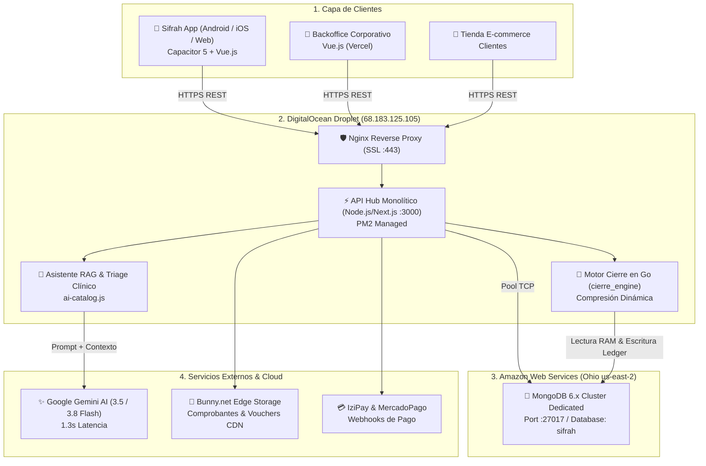

# 01. Arquitectura Global del Ecosistema Sifrah

## 🌐 Visión General

Sifrah es una plataforma tecnológica que combina:
1. **Comercio electrónico y red multinivel (MLM)** con planes de compensación Unilevel y Binario Híbrido.
2. **Motor de liquidación financiera masiva** en Golang con concurrencia por Goroutines.
3. **Asistente médico-nutricional RAG** impulsado por Google Gemini 3.5 Flash Lite y Gemini 3.8 Flash con salvaguardas clínicas.
4. **Modelos predictivos de liderazgo y retención** desarrollados con Scikit-Learn en Python.

---

## 🏛️ Topología de Infraestructura Cloud

---

## ⚙️ Componentes Clave

### 1. Servidor de Producción (DigitalOcean)
- **IP Pública:** `68.183.125.105`
- **Ruta del Proyecto:** `/var/www/sifrah-server`
- **Dominio API:** `api.serve-sifrah.xyz`
- **Gestor de Procesos:** PM2 con cluster mode y auto-reinicio.
- **Acceso SSH:** Llave privada `sifrah_dev_key.pem`.

### 2. Base de Datos Central (AWS EC2)
- **Host:** `ec2-18-220-240-71.us-east-2.compute.amazonaws.com`
- **Puerto:** `27017`
- **Autenticación:** Credenciales seguras con usuario administrativo y réplicas.
- **Backups:** Automatizados con script `mongodump` comprimido y subido diariamente a Bunny.net Storage.

### 3. Diagramas Vectoriales Interactivos
El repositorio incluye diagramas vectoriales interactivos compilados con **Archify**:
- [`sifrah-architecture.html`](file:///Users/jordymontalvo/proyectos/sifrah/sifrah-docs/archify_diagrams/sifrah-architecture.html): Mapeo completo navegable de componentes.
- [`sifrah-cierre-workflow.html`](file:///Users/jordymontalvo/proyectos/sifrah/sifrah-docs/archify_diagrams/sifrah-cierre-workflow.html): Flujo animado del cierre de periodo.
- [`sifrah-assistant-sequence.html`](file:///Users/jordymontalvo/proyectos/sifrah/sifrah-docs/archify_diagrams/sifrah-assistant-sequence.html): Secuencia RAG de interacción con el asistente de salud.
