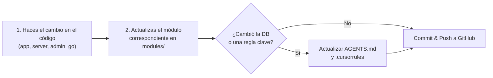

# 📘 Guía de Contribución: Cómo Documentar Nuevos Cambios en Sifrah

Esta guía define el protocolo estándar para que cualquier desarrollador del equipo mantenga la documentación sincronizada cada vez que implemente una nueva característica, cambio de arquitectura o refactorización.

---

## ⚡ El Flujo en 3 Pasos



---

## 📂 1. ¿Qué archivo actualizar según el cambio?

| Tipo de Cambio | Dónde documentarlo en este repo | Qué detalles incluir |
| :--- | :--- | :--- |
| **Nuevo Endpoint o Lógica de Backend** | [`modules/03-backend-api-hub.md`](modules/03-backend-api-hub.md) | Método HTTP, ruta, payload esperado, headers y respuesta JSON. |
| **Cambio en el Esquema de Base de Datos** | [`modules/06-esquemas-mongodb.md`](modules/06-esquemas-mongodb.md) y [`AGENTS.md`](AGENTS.md) | Nuevos campos, tipos de datos, índices y valores por defecto. |
| **Modificación de Bonos o Reglas MLM** | [`modules/04-cierre-engine-golang.md`](modules/04-cierre-engine-golang.md) y [`AGENTS.md`](AGENTS.md) | Fórmulas, porcentajes, condiciones de calificación y tests en Go. |
| **Nueva Pantalla en App Móvil o Admin** | [`modules/02-frontends-app-admin.md`](modules/02-frontends-app-admin.md) | Nombre del componente Vue, ruta, llamadas a Vuex y permisos. |
| **Nuevo Producto, Dolencia o Combo IA** | [`modules/05-ia-rag-asistente.md`](modules/05-ia-rag-asistente.md) | Tags de dolencia, productos combinados, puntos PTS asignados. |
| **Cambio de Infraestructura o Variables .env** | [`modules/08-devops-y-despliegues.md`](modules/08-devops-y-despliegues.md) | Nuevas variables de entorno, puertos, servicios o migraciones. |

---

## 🤖 2. El "Prompt Mágico" (Deja que tu IA documente por ti)

Para que al equipo no le tome tiempo redactar a mano, cualquier desarrollador puede copiar este prompt en su **Cursor, Claude Code o Copilot**:

```markdown
Revisa los cambios que acabo de realizar en el código (git diff).
Genera un resumen técnico en formato Markdown para documentarlo en el repositorio `documentationsifrah`:
1. Identifica qué módulo de `modules/` debe actualizarse (01 al 08).
2. Redacta la sección correspondiente explicando qué cambió, por qué cambió, y cómo se prueba.
3. Si se agregaron campos a la base de datos o cambiaron reglas del negocio, redacta también la adición para `AGENTS.md`.
```

---

## ⚠️ 3. Regla de Oro: Actualizar siempre `AGENTS.md`

Si el cambio que hará tu equipo altera:
1. **Nombres de campos en MongoDB** (ej. se agrega `wallet_pin`, o se cambia `status`).
2. **Una regla financiera o contable** (ej. cambio en el porcentaje del bono binario).
3. **El flujo de despliegue o variables de entorno**.

👉 **ES OBLIGATORIO** agregar esa regla a [`AGENTS.md`](AGENTS.md). De lo contrario, los demás desarrolladores que usen IA recibirán código desactualizado o alucinaciones.

---

## 🚀 4. Guardar y Publicar en GitHub

```bash
cd documentationsifrah
git add .
git commit -m "docs: actualizar módulo de comisiones con bono nuevo"
git push origin master
```
*Si GitHub Pages está activo, la web se actualizará automáticamente en menos de 60 segundos.*
