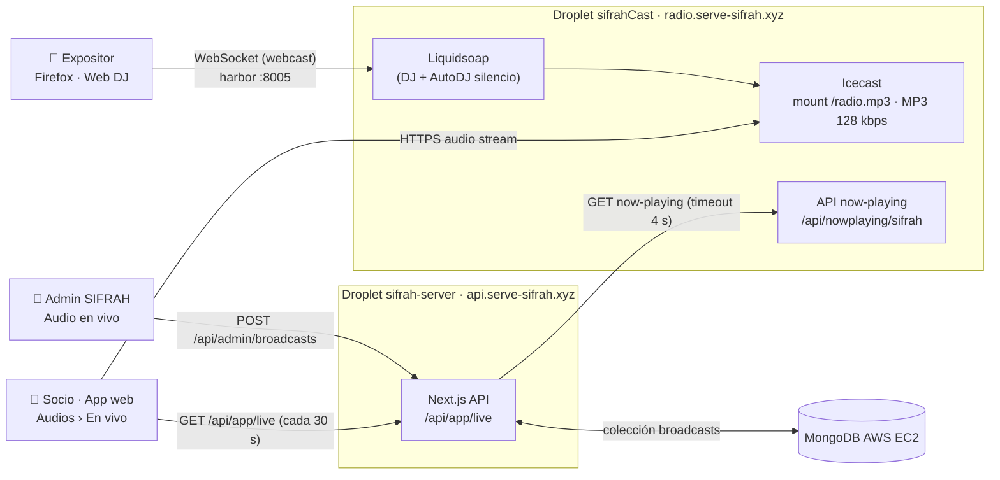
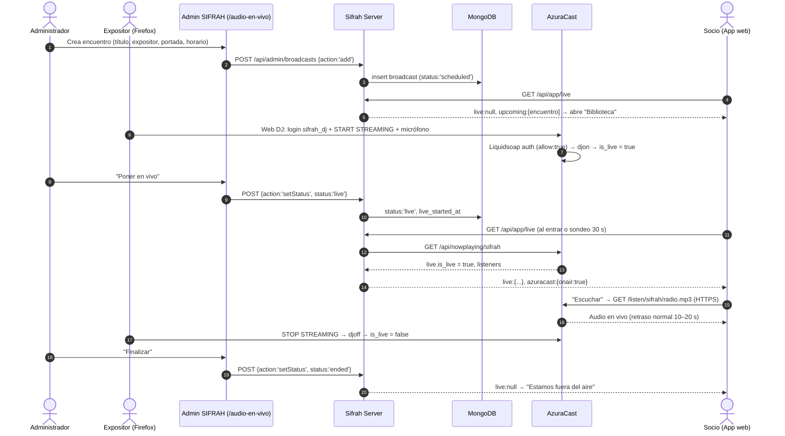
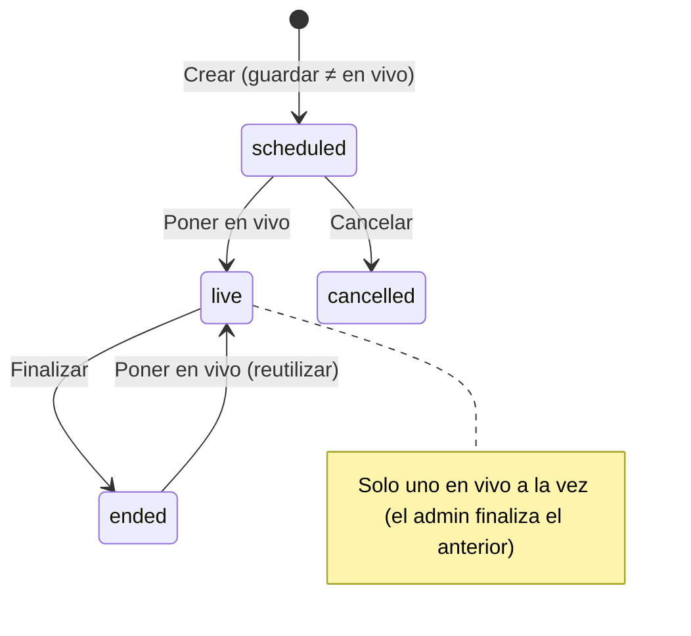

# 🎙️ Audio en Vivo: Transmisiones con AzuraCast dentro de Universidad SIFRAH

Este módulo documenta el funcionamiento técnico, operativo y de negocio del **Audio en Vivo** de Sifrah: un expositor transmite su voz en tiempo real (como una radio por internet) y los socios lo escuchan **dentro de la propia app/web de SIFRAH**, sin descargar otra aplicación ni entrar a una página externa.

> **Alcance actual:** versión **web** (expositor desde navegador + socios escuchando en la app web, incluida la web en celular). La capa **móvil nativa (Capacitor: audio en segundo plano)** queda pendiente.
>
> **Especificación funcional de origen:** `SIFRAH_Audio_en_Vivo_Documentacion.pdf` (20/10/2026).

---

## 🎯 1. Propósito y Decisiones de Diseño

1. **Cercanía con la comunidad:** compartir el mismo momento con el expositor (liderazgo, desarrollo personal, productos, negocio, testimonios, comunicados).
2. **Todo dentro de SIFRAH:** el apartado **Audios** (Universidad SIFRAH) tiene dos pestañas: **Biblioteca** (audios grabados, ya existente) y **En vivo** (nuevo). No se agrega un menú "Mixlr/AzuraCast" al socio.
3. **"Programado ≠ En vivo":** publicar o programar un encuentro **nunca** lo pone en el aire. El estado en vivo es una acción explícita del administrador y además se contrasta con la señal real del servidor de audio.
4. **Sin asumir "fuera del aire" ante fallos:** si no se puede comprobar el estado, se informa un problema de conexión en lugar de declarar que no hay transmisión.

### ¿Por qué AzuraCast y no Mixlr?

La especificación proponía **Mixlr**. Se evaluó y se eligió **AzuraCast** (software libre, self-hosted):

| Criterio | Mixlr | AzuraCast (elegido) |
| :--- | :--- | :--- |
| Costo | ~$49–150/mes; API/SDK solo en plan **Enterprise** | Gratis; solo el droplet (~$18/mes) |
| URL de stream para reproductor propio | Solo en planes pagos | ✅ Sí (mount MP3) |
| Detección real de "en vivo" | ❌ Sin API en planes no-Enterprise | ✅ API `now-playing` (`live.is_live`) |
| Transmisión desde el navegador | ✅ | ✅ **Web DJ** (HTTPS) |
| Transmisión desde celular | ✅ App propia | 🟡 Requiere app *source* de terceros (no turnkey) |
| Control de marca / UI | Limitado (iframe) | Total (reproductor propio en SIFRAH) |

---

## 🏗️ 2. Arquitectura



**Fuentes de verdad:**
- **Metadatos y estado del encuentro** (título, expositor, portada, horario, `status`): colección `broadcasts` en SIFRAH.
- **Señal real de emisión** (¿el DJ está conectado?, nº de oyentes): API `now-playing` de AzuraCast.
- **Audio:** se reproduce **directo desde AzuraCast** (Icecast); no pasa por el server de SIFRAH.

---

## 🔄 3. Flujo Completo (End-to-End)



---

## 🗄️ 4. Modelo de Datos: Colección `broadcasts`

Modelo `Broadcast` en `server/components/db.js` (`new MongoWrapper('broadcasts')`). Separada de `audios` (Biblioteca).

| Campo | Tipo | Descripción |
| :--- | :--- | :--- |
| `id` | string | ID generado con `lib.rand()` |
| `title` | string | **Requerido.** Ej. "Conecta con tu propósito" |
| `author` | string | Expositor. Default `"Equipo SIFRAH"` |
| `description` | string | Descripción breve |
| `image` | string | URL de portada (Bunny CDN, carpeta `audios`) |
| `scheduled_start` / `scheduled_end` | ISO string \| null | Horario programado (UTC; el admin lo ingresa en hora de Perú) |
| `timezone` | string | Siempre `"America/Lima"` |
| `status` | enum | `scheduled` \| `live` \| `ended` \| `cancelled` |
| `stream_url` | string | URL de oyente. **Vacío = usa `AZURACAST_STREAM_URL`** |
| `station` | string | Shortcode AzuraCast. **Vacío = usa `AZURACAST_STATION`** |
| `live_started_at` / `live_ended_at` | Date | Se registran al pasar a `live` / `ended` |
| `created_at` / `updated_at` | Date | Auditoría |

**Ciclo de vida:**



---

## 🔌 5. Endpoints del Backend (`server/pages/api/`)

### A. `admin/broadcasts.js` — Gestión (requiere sesión de **admin**)
Autenticación con `requireAdmin` (sesión en `Authorization: Bearer <session>`): sin sesión → **401**, usuario no admin → **403**.

| Método | Payload | Efecto |
| :--- | :--- | :--- |
| `GET` | — | `{ broadcasts: [...] }` ordenados por `scheduled_start` desc |
| `POST` | `{ action:'add', data }` | Crea con `status` por defecto `scheduled`. Sin `title` → `{error:true}` |
| `POST` | `{ action:'edit', id, data }` | Actualiza contenido. Campos `undefined` no se tocan; **no cambia el estado si no se envía** |
| `POST` | `{ action:'setStatus', id, status }` | Cambio explícito de estado. Estado inválido → `{error:true, msg:'Invalid status'}` |
| `POST` | `{ action:'delete', id }` | Elimina el encuentro |
| `DELETE` | `{ id }` | Elimina el encuentro |

### B. `app/live.js` — Estado para el socio
`GET /api/app/live` (middleware `midd`, igual que `/api/app/audios`).

```json
{
  "error": false,
  "live": {
    "id": "…", "title": "Conecta con tu propósito", "author": "Jesús Muñoz",
    "image": "https://…", "status": "live",
    "stream_url": "https://radio.serve-sifrah.xyz/listen/sifrah/radio.mp3"
  },
  "upcoming": [ { "id": "…", "title": "…", "scheduled_start": "2026-12-01T00:00:00.000Z" } ],
  "azuracast": { "configured": true, "reachable": true, "onair": true, "listeners": 12, "streamer": "SIFRAH en vivo" },
  "server_time": "2026-10-21T19:53:45.099Z"
}
```

Reglas:
- **`live`**: el encuentro con `status:'live'` (si hubiera varios, el de `live_started_at` más reciente). `null` si no hay ninguno.
- **`upcoming`**: `status:'scheduled'` con fecha futura (orden ascendente) y luego los **sin fecha** al final; máximo 10. Excluye pasados, finalizados y cancelados.
- **`azuracast`**: solo se consulta si hay `live`. Llama `GET {AZURACAST_BASE_URL}/api/nowplaying/{station}` con timeout de 4 s:
  - `configured:false` → faltan variables de entorno (el estado depende solo del admin).
  - `reachable:false, onair:null` → AzuraCast no respondió: **no** se asume fuera del aire.
  - `onair:false` → AzuraCast responde que **no hay DJ conectado** → la app muestra "Esperando al expositor…".
  - `onair:true` → transmisión real confirmada.

---

## 💻 6. Componentes Frontend

### A. App del socio (`app/`)

**`views/app/Audios.vue`** — pestañas **Biblioteca | En vivo**:
- **Regla de apertura (solo al entrar):** con transmisión activa → **En vivo**; sin transmisión → **Biblioteca**. `?tab=en-vivo` fuerza En vivo (enlace del calendario).
- **Sondeo** de `/api/app/live` cada **30 s**. Si empieza una emisión mientras el socio navega la Biblioteca, **no** se le cambia la vista: aparece el aviso **"Estamos en vivo · Escuchar"**.
- **Nunca suenan dos audios a la vez:** al dar Escuchar en vivo se pausa la Biblioteca y viceversa.

**`components/LiveAudioPlayer.vue`** — reproductor propio (identidad SIFRAH: blanco, fucsia `#E91E63`, tarjetas redondeadas):

| Estado | Condición | UI |
| :--- | :--- | :--- |
| Error de comprobación | `/api/app/live` falló | "No pudimos comprobar la transmisión" + Reintentar |
| Fuera del aire | `live === null` | Tarjeta gris "Estamos fuera del aire · Pronto volveremos a conectar", Escuchar deshabilitado |
| En vivo (antes de escuchar) | `live` presente | Tarjeta fucsia: badge EN VIVO, portada, título, expositor, botón **Escuchar** |
| Esperando al expositor | `configured && reachable && onair === false` | Spinner "Esperando al expositor…", Escuchar deshabilitado |
| Conectando / Reconectando | Tras Escuchar, hasta el evento `playing` | Spinner; **nunca** dice "escuchando" sin audio real |
| Escuchando | Evento `playing` | Ondas animadas, "Estás escuchando en vivo", Pausar, volumen |
| Error | 5 reintentos fallidos | "No se pudo reproducir la transmisión" |

Detalles técnicos:
- El `src` del `<audio>` solo se asigna al pulsar Escuchar (`preload="none"`). **Pausar** quita el `src` y corta la descarga.
- **Retomar el directo** = reconectar al punto en vivo (se agrega `?_t=<timestamp>` a la URL), no continuar lo almacenado.
- **Reconexión automática** con backoff exponencial (máx. 15 s entre intentos, 5 intentos).
- El contador de oyentes solo se muestra si es mayor a 0.
- **Próximas transmisiones:** fecha en hora de Perú ("Viernes, 23 de octubre…, (hora de Perú)").
- **Recordarme:** Google Calendar (`ctz=America/Lima`) o descarga de `.ics` (Apple/Outlook). Incluye título, inicio/fin (1 h por defecto si no hay fin), descripción, expositor y enlace de regreso `/audios?tab=en-vivo` (si pide login, luego continúa al apartado).

### B. Panel Admin (`admin/`)

**`views/Broadcasts.vue`** — ruta **`/audio-en-vivo`**, menú **"Audio en vivo"** (debajo de "Audio"):
- Tabla con portada, título, expositor, inicio programado (hora de Perú), estado (Programado / EN VIVO / Finalizado / Cancelado) y contadores.
- Modal crear/editar: título*, expositor, estación AzuraCast, URL del stream, descripción, portada (subida a Bunny con `lib.uploadBuffer(..., "audios")`), inicio y fin (`datetime-local` en hora de Perú UTC-5; helpers `limaLocalToIso` / `isoToLimaLocal`). El estado **no** se edita en el formulario.
- Acciones: **Poner en vivo** (scheduled/ended), **Finalizar** (live), **Cancelar** (scheduled), **Editar**, **Eliminar**. Si ya hay otro encuentro en vivo, pide confirmación y lo finaliza antes.
- Aviso fijo: *"Guardar o programar un encuentro no inicia la transmisión. Usa «Poner en vivo» solo cuando el expositor ya esté transmitiendo desde AzuraCast."*
- Clientes API: `admin/src/api.js` → `api.broadcasts`; `app/src/api.js` → `api.Live`.

---

## ☁️ 7. Infraestructura: Servidor AzuraCast

| Elemento | Valor |
| :--- | :--- |
| Droplet | `sifrahCast` · `24.199.93.133` · `s-2vcpu-2gb` (2 vCPU, 2 GB RAM, 60 GB, 3 TB/mes) · Ubuntu 24.04 LTS |
| Acceso SSH | `root@24.199.93.133` con la misma llave del server (`sifrah_dev_key.pem`) — usar `-o IdentitiesOnly=yes` |
| Swap | 2 GB (`/swapfile`, `vm.swappiness=10`) — protege las actualizaciones con 2 GB de RAM |
| Instalación | Docker oficial en `/var/azuracast` (`docker.sh`), canal **Stable** |
| Dominio | `radio.serve-sifrah.xyz` → registro **A** a `24.199.93.133` (DNS en el registrador) |
| HTTPS | Let's Encrypt (renovación automática). **Obligatorio:** la app es HTTPS (mixed content) y el Web DJ necesita HTTPS para el micrófono |
| Estación | `sifrah` (id 1) · Icecast + Liquidsoap · TZ `America/Lima` · streamers/DJ **activados** |
| Mount de oyentes | `/radio.mp3` · **MP3 128 kbps** (Ogg no funciona en Safari/iOS) |
| URL de oyente | `https://radio.serve-sifrah.xyz/listen/sifrah/radio.mp3` |
| Web DJ (expositor) | `https://radio.serve-sifrah.xyz/public/sifrah/dj` |
| Cuenta DJ | usuario `sifrah_dj` (contraseña gestionada en AzuraCast → *Streamers/DJ Accounts*) · puerto DJ `8005` |
| Puertos publicados | 80, 443, 2022 (SFTP), 8000–8496 (estaciones/DJ) |

### ⚠️ Playlist de silencio (NO borrar)
La estación tiene la playlist **"Fuera del aire (silencio)"** con una pista de 30 s de silencio, `avoid_duplicates=false` y `duplicate_prevention_time_range=0`.

**Por qué existe:** sin ninguna playlist de AutoDJ, la tarea *now-playing* de AzuraCast falla ("No track to update" / "Station Offline") y **`live.is_live` nunca pasa a `true` aunque el DJ esté transmitiendo**. Además, fuera del aire los oyentes escucharían el jingle de error de Icecast. Con la playlist, fuera del aire suena silencio y el estado en vivo se reporta correctamente.

### Variables de entorno del server (`/var/www/sifrah-server/.env`)

| Variable | Valor en producción | Uso |
| :--- | :--- | :--- |
| `AZURACAST_BASE_URL` | `https://radio.serve-sifrah.xyz` | Base de la API `now-playing` |
| `AZURACAST_STATION` | `sifrah` | Shortcode por defecto si el encuentro no trae `station` |
| `AZURACAST_STREAM_URL` | `https://radio.serve-sifrah.xyz/listen/sifrah/radio.mp3` | URL de oyente por defecto si el encuentro no trae `stream_url` |

Tras cambiarlas: `pm2 restart sifrah-server --update-env` (en ese droplet hay que cargar nvm antes: `. /root/.nvm/nvm.sh`).

### Capacidad estimada
A 128 kbps, **1 hora con 300 oyentes ≈ 17 GB** de tráfico. Los 3 TB/mes del droplet alcanzan para ~175 horas/mes con 300 oyentes simultáneos. Servir audio casi no consume CPU; el límite real es el ancho de banda.

---

## 🧑‍🏫 8. Guía Operativa

### Para el expositor (transmitir)
1. Usar **Firefox** (ver Troubleshooting: Chrome con micrófono real corta la transmisión).
2. Abrir `https://radio.serve-sifrah.xyz/public/sifrah/dj`.
3. Ingresar usuario `sifrah_dj` y la contraseña. Dejar **44.1 kHz / 128 kbps**.
4. Pulsar **START STREAMING**.
5. En la tarjeta **Microphone** elegir el micrófono en *Microphone Source* y activarlo con el **botón rojo**.
6. (Opcional) Título/Artista en *Update Metadata*.
7. Hablar. No cerrar ni cambiar la pestaña. Al terminar, **STOP STREAMING**.

### Para el administrador (operar un encuentro)
1. **Antes:** Admin → **Audio en vivo** → **Nuevo encuentro** (título, expositor, portada, horario). Dejar vacíos URL del stream y estación (usa los del server). Aparece en "Próximas transmisiones".
2. **Al iniciar:** confirmar que el expositor ya está transmitiendo y pulsar **Poner en vivo**.
3. **Al terminar:** pulsar **Finalizar** (y el expositor STOP STREAMING).

> Mientras un encuentro está **en vivo, lo ven todos los socios**. Para pruebas usar títulos como "Prueba técnica" y horarios tranquilos.

---

## 🛠️ 9. Troubleshooting

| Síntoma | Causa | Solución |
| :--- | :--- | :--- |
| Web DJ no deja entrar; log `"allow":false` | Contraseña incorrecta (p. ej. un carácter extra al copiar) | Escribirla a mano; revisar en AzuraCast → Streamers |
| Conecta y se corta a los 8–13 s; log `Feeding stopped: Avutil.Error(Invalid data found when processing input)` | **Chrome con micrófono real** genera audio que Liquidsoap no decodifica (AzuraCast recomienda Firefox) | **Usar Firefox.** Alternativa: encoder de escritorio (BUTT) |
| App muestra "Esperando al expositor…" | Encuentro `live` en SIFRAH pero AzuraCast reporta `is_live=false` | El expositor debe iniciar el Web DJ; se actualiza en 30–45 s |
| `is_live` siempre `false` con DJ conectado / "Station Offline" | Estación sin playlist de AutoDJ | Restaurar la playlist de silencio (sección 7) |
| `GET /api/nowplaying/sifrah` → 404 "Record not found" | Caché now-playing aún no generada | `docker exec azuracast azuracast_cli azuracast:sync:nowplaying:station sifrah` |
| "DNS address could not be found" solo en una red | Caché negativa del router (se consultó antes de crear el registro A; TTL negativo ~1 h) | Usar DNS 1.1.1.1/8.8.8.8, reiniciar el router o esperar |
| Certificado autofirmado (`CN=localhost`) | Let's Encrypt aún no emitido | `docker exec azuracast azuracast_cli azuracast:acme:get-certificate` |
| Log ACME "Certificate does not need renewal" | Informativo: el certificado sigue vigente | Nada |
| El audio no carga en la app (HTTPS) | Stream servido por `http://` (mixed content) | Mantener `always_use_ssl` y URLs `https://` |

**Logs útiles (droplet AzuraCast):**
```bash
docker exec azuracast sh -c "tail -f /var/azuracast/stations/sifrah/config/liquidsoap.log"   # DJ: auth/djon/djoff/errores
curl -s https://radio.serve-sifrah.xyz/api/nowplaying/sifrah                               # estado en vivo
```

---

## ✅ 10. Pruebas Realizadas

1. **E2E local (aislado de producción)** — Mongo desechable + AzuraCast simulado + server/app/admin locales:
   - **API: 36/36 OK** (seguridad 401/403, CRUD, programado ≠ en vivo, orden de próximas, señal AzuraCast con DJ conectado/desconectado/API caída).
   - **UI con Playwright: 30/30 OK** (admin crea y pone en vivo; regla de apertura; Escuchar con audio real; Pausar corta descarga; aviso en Biblioteca; Esperando al expositor; fuera del aire; Recordarme Google/.ics; `?tab=en-vivo`; sin scroll horizontal a 390 px; sin errores JS).
2. **Servidor real:** cliente DJ → `is_live=true` en ~16 s y voz verificada en el stream HTTPS (RMS); al desconectar vuelve a `is_live=false`.
3. **Prueba de aceptación con usuario (21/10/2026):** Web DJ en **Firefox** ~2 min estable, encuentro en vivo en SIFRAH con `onair=true`, socio escuchando desde el celular. ✅

Commits: server `c3a0f8f`, app `c55ccd7`, admin `cc9bf82`.

---

## 📌 11. Pendientes y Limitaciones Conocidas

- **App móvil nativa (Capacitor):** audio con pantalla bloqueada / en segundo plano y transmisión del expositor desde el celular — pendiente de definición.
- **Acceso exclusivo a socios:** la URL del stream es **pública** (quien la tenga puede escuchar) y `/api/app/live` usa el mismo middleware que `/api/app/audios`. Si se requiere exclusividad: proxy del stream por el server con validación de sesión.
- **Chrome no soportado para transmitir** con micrófono real; usar Firefox.
- **Avisos propios de SIFRAH** (notificaciones push) son distintos de "Recordarme" (calendario) y no están implementados.
