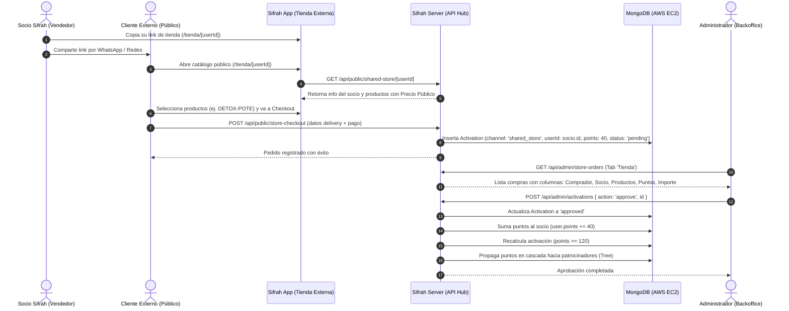

# 🏪 Tienda Externa Compartida: Catálogo Público, Compras y Acreditación de Puntos

Este módulo documenta en detalle el funcionamiento técnico y de negocio de la **Tienda Externa Compartida** de Sifrah, un mecanismo mediante el cual los socios distribuidores pueden comercializar productos directamente al público general a través de enlaces personalizados y acumular los puntos (**PTS**) de cada venta para su activación y rango en la red.

---

## 🎯 1. Propósito y Filosofía de Negocio

1. **Venta al Público por Referencia:** Cada socio activo de Sifrah dispone de un link único (`/tienda/[userId]`) que puede compartir en redes sociales, WhatsApp o campañas digitales.
2. **Precios Diferenciados:** En la tienda externa se muestra el **Precio Público** (`public_price`), garantizando el margen de ganancia comercial de la compañía y respetando la política de precios de venta final.
3. **Ocultamiento de Puntos al Comprador:** Los clientes externos no forman parte de la red multinivel; por tanto, los badges y etiquetas de puntos (**PTS**) permanecen ocultos en la interfaz pública para ofrecer una experiencia de e-commerce limpia y convencional.
4. **Atribución Automática de Puntos al Socio:** Toda compra confirmada realizada en el enlace de un socio acredita el 100% de los puntos de los productos comprados al socio titular del enlace (`owner.id`), contribuyendo a su calificación de activación mensual (mínimo 120 PTS) y a su volumen de red.

---

## 🔄 2. Flujo Completo del Proceso (End-to-End)



---

## 💻 3. Componentes Frontend Involucrados

### A. App Cliente (`app/`)
- **`app/src/views/public/SharedStore.vue`:**
  - Vista del catálogo público renderizada al acceder a `/tienda/:userId`.
  - Presenta el banner de bienvenida con el nombre del socio vendedor.
  - Oculta etiquetas o menciones de puntos para evitar confusión en el comprador final.
  - Emplea el `public_price` del producto como precio oficial.
- **`app/src/views/public/StoreCheckout.vue`:**
  - Formulario de entrega (dirección, departamento, provincia, distrito y cotización de delivery).
  - Selección de método de pago: Depósito/Transferencia con voucher o pasarela de tarjeta.
  - Emisión de Boleta o Factura electrónica.

### B. Panel Corporativo (`admin/`)
- **`admin/src/views/StoreOrders.vue` (Sub-tab "Tienda" en Afiliaciones):**
  - Ubicado en la ruta `/tienda` dentro del ecosistema administrativo.
  - **Métricas Superiores:** Total de compras, compras pendientes, compras aprobadas e importe acumulado.
  - **Tabla de Compras:**
    - `Pedido`: Identificador numérico del pedido.
    - `Fecha`: Marca de tiempo del pedido.
    - `Comprador`: Nombre completo, DNI y teléfono del cliente externo.
    - `Socio`: Nombre y DNI del distribuidor titular de la tienda compartida.
    - `Productos`: Detalle y cantidades de los ítems adquiridos.
    - **`Puntos` (Nueva Columna):** Insignia azul estilizada con icono de estrella que muestra los puntos generados por la compra (ej. `40 pts`).
    - `Importe`: Monto en Soles (PEN) abonado por la compra.
    - `Comprobante / Entrega`: Estado financiero del voucher y tracking de despacho.
    - `Acciones`: Botones de *Aprobar*, *Rechazar*, *Ver compra*, *Validar comprobante* y *Anular*.
  - **Modal de Detalle ("Ver compra"):**
    - Muestra los productos, el importe, datos del cliente, dirección de despacho, imagen del comprobante y el campo explícito **Puntos generados**.

---

## ⚙️ 4. Endpoints y Lógica de Backend (`server/`)

### 1. Registro de la Orden (`server/pages/api/public/store-checkout.js`)
Al recibir el pedido del comprador externo:
1. Valida la existencia del socio dueño del enlace: `const owner = await User.findOne({ id: userId })`.
2. Calcula el total de productos y puntos:
   ```javascript
   const points = products.reduce((sum, item) => sum + item.points * item.total, 0);
   ```
3. Registra el documento en la colección `activations`:
   ```javascript
   await Activation.insert({
     id: orderId,
     date: new Date(),
     userId: owner.id,           // <- Socio que recibe los puntos
     channel: "shared_store",    // <- Identificador de tienda compartida
     products,
     price,
     points,                     // <- Puntos acumulados de los productos
     total,
     status: "pending",
     delivered: false,
     office: null,               // <- Sin sucursal física requerida
     buyer: { name, document, phone, email },
     delivery_info: { ... }
   });
   ```

### 2. Listado Administrativo (`server/pages/api/admin/store-orders.js`)
Filtra únicamente las compras con `channel: "shared_store"`:
- Resuelve el nombre y DNI del socio vendedor mediante `User.find({ id: { $in: sellerIds } })`.
- Mapea y retorna el campo `points` de cada compra para que la tabla administrativa lo visualice.
- Calcula el resumen global con el importe y los puntos acumulados.

### 3. Aprobación y Acreditación de Puntos (`server/pages/api/admin/activations.js`)
Al aprobar una compra desde el panel de Tienda (`action === "approve"`):
1. **Actualización del Socio:**
   ```javascript
   const user = await User.findOne({ id: activation.userId });
   const points_total = (Number(user.points) || 0) + (Number(activation.points) || 0);

   const wasActivatedBefore = user.activated;
   const activated = user.activated ? true : points_total >= 120;

   await User.update({ id: user.id }, { activated, points: points_total });
   ```
2. **Propagación en Árbol MLM:**
   ```javascript
   await lib.updateTotalPointsCascade(User, Tree, user.id);
   ```
   Recalcula el `total_points` del socio y de toda su línea ascendente en el árbol genealógico.
3. **Manejo Seguro de Sucursal/Stock:**
   Las compras de tienda externa tienen `office: null` (se despachan por courier nacional o almacén central). El sistema verifica `if (office_id) ...` antes de manipular inventario local para evitar excepciones por referencia nula.
4. **Reversión en caso de Anulación (`action === "cancel"`):**
   Si una orden aprobada se anula posteriormente, el backend descuenta exactamente los puntos sumados (`Math.max(0, currentPts - actPts)`), revalúa la condición de activación y actualiza la cascada.

---

## 🗄️ 5. Campos de Base de Datos (MongoDB)

### Colección `products`:
| Campo | Tipo | Descripción |
| :--- | :--- | :--- |
| `public_price` | `Number` | Precio de venta al público en la tienda externa (ej. `140.00`). |
| `price_socio` | `Number` | Precio preferencial para distribuidores de la red. |
| `points` | `Number` | Puntos asignados al producto para activación y rangos (ej. `40`). |

### Colección `activations` (con `channel: 'shared_store'`):
| Campo | Tipo | Descripción |
| :--- | :--- | :--- |
| `channel` | `String` | `"shared_store"` para diferenciar compras de tienda externa de activaciones internas. |
| `userId` | `String` | ID del socio distribuidor que compartió su enlace y recibe los puntos. |
| `points` | `Number` | Puntos totales generados por los productos comprados. |
| `price` | `Number` | Importe total pagado por el comprador (productos + delivery). |
| `buyer` | `Object` | Datos del comprador externo (`name`, `document`, `phone`, `email`). |
| `delivery_info` | `Object` | Dirección, cotización y guía de despacho a domicilio. |
| `status` | `String` | `"pending"` | `"approved"` | `"rejected"` | `"cancelled"`. |

---

## 🧪 6. Guía de Pruebas y Validación

1. **Prueba de Creación de Orden:**
   - Iniciar sesión como socio en la App y obtener el link de tienda compartida en *Herramientas > Compartir Tienda*.
   - Abrir el enlace en modo incógnito: verificar que los productos exhiban el `public_price` y que los puntos estén ocultos.
   - Completar una compra con el producto `DETOX-POTE` (40 pts) adjuntando comprobante.
2. **Prueba en Panel Corporativo:**
   - Ingresar a `Admin > Afiliaciones > Tienda`.
   - Verificar que aparezca el pedido con la columna **Puntos** mostrando `40 pts` y el nombre del socio vendedor correcto.
3. **Prueba de Acreditación de Puntos:**
   - Hacer clic en el botón de acción verde **Aprobar**.
   - En `Admin > Usuarios`, buscar al socio vendedor y verificar que sus puntos personales se hayan incrementado en 40 pts.
   - Comprobar que en su red ascendente el `total_points` se haya actualizado en cascada.
