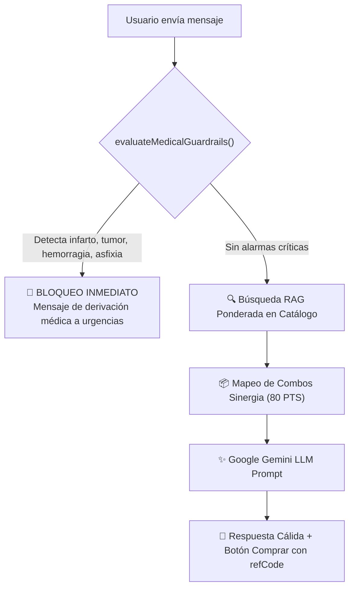

# 05. Inteligencia Artificial & Asistente RAG

El asistente conversacional de bienestar de Sifrah está diseñado para orientar a clientes y prospectos sobre el catálogo de suplementos nutricionales mediante una arquitectura de Recuperación Aumentada por Generación (RAG) y salvaguardas clínicas rigurosas.

---

## 🩺 1. Triage Clínico y Guardrails Médicos

La seguridad legal y médica es la máxima prioridad:



### Palabras de Bloqueo Crítico:
- Dolor torácico severo opresivo, posible infarto.
- Cáncer diagnosticado, quimioterapia, tumores malignos.
- Hemorragias activas profusas, vómitos con sangre.
- Dificultad respiratoria severa / asfixia aguda.
- Pérdida súbita del conocimiento, convulsiones.

---

## 🌿 2. Catálogo Semántico & Combos de Salud (80 PTS)

Ubicado en [`server/components/ai-catalog.js`](file:///Users/jordymontalvo/proyectos/sifrah/server/components/ai-catalog.js):

* **Ponderación de Relevancia:**
  * Dolencias coincidentes: peso 5
  * Etiquetas (tags): peso 3
  * Beneficios generales: peso 2
* **Combos Automáticos de Cross-Selling:**
  * **Articulaciones & Cartílagos:** *Rejuvenece (Colágeno) + Detox (Clorofila)* $\rightarrow$ 80 PTS
  * **Gastritis & Digestión:** *Regenera T + Detox* $\rightarrow$ 80 PTS
  * **Energía & Rendimiento:** *Maca Negra + Energizante* $\rightarrow$ 80 PTS

---

## ⚡ 3. Cascada de Modelos Gemini

1. **Primario:** `gemini-3.5-flash-lite` (Google Generative AI). Latencia sub-segundo (~1.3s) y alta disponibilidad.
2. **Secundario (Fallback):** `gemini-3.8-flash` para consultas complejas o en caso de rate limit.
3. **Respaldo Local Heurístico:** Generador de respuestas locales si la API externa sufre caídas de red.

---

## 📊 4. Telemetría y Analítica en MongoDB

Cada interacción con el bot se almacena de forma asíncrona (sin bloquear el tiempo de respuesta al usuario) en la colección `assistant_conversations`:

```json
{
  "_id": "670d8a1...",
  "user_id": "socio_123",
  "ref_code": "LUIS2026",
  "query": "Me duelen mucho las rodillas al subir escaleras",
  "detected_ailments": ["articulaciones", "dolor_rodilla"],
  "recommended_products": ["REJUVENECE_COLLAGEN", "DETOX_CHLOROPHYLL"],
  "recommended_combo": "COMBO_ARTICULAR_PRO",
  "total_points": 80,
  "model_used": "gemini-3.5-flash-lite",
  "latency_ms": 1340,
  "created_at": "2026-10-13T12:00:00Z"
}
```
Esto permite a la directiva analizar cuáles son las dolencias de salud más consultadas en cada departamento y planificar campañas comerciales.
